<p align="center">
  <a href="https://daeese.me">
    <picture>
      <source media="(prefers-color-scheme: dark)" srcset="assets/header-dark.svg" />
      
    </picture>
  </a>
</p>

<p align="center">
  <a href="https://daeese.me">daeese.me</a>
  &nbsp;·&nbsp;
  <a href="https://apps.daeese.me">apps.daeese.me</a>
  &nbsp;·&nbsp;
  <a href="https://github.com/nunreasonable">@nunreasonable</a>
</p>

<p align="center"></p>

```
daeese; daeeseD; nunreasonable; wtv
```

### About

Won't really say much except:

- Fullstack developer @ [VLTRA Entertainment](https://discord.gg/3qdvhkNSS8)
- I work with C#, JS, HTML & CSS, plus Luau for Roblox and lately C++ / Qt and Rust for ii on Windows

### Toolbox

<p>
  
</p>

<p align="center"></p>

### Projects

<a href="https://apps.daeese.me/illogicalwindows/">
  <picture>
    <source media="(prefers-color-scheme: dark)" srcset="assets/ii-windows-dark.svg" />
    
  </picture>
</a>

#### [Illogical Windows](https://github.com/nunreasonable/ii-windows)

end-4's [illogical-impulse](https://github.com/end-4/dots-hyprland) Quickshell desktop, ported from Hyprland to run natively on Windows 10 and 11, through a Quickshell fork with a native Windows backend (C++, Qt 6 / QML, Direct3D 11, WinRT). Spotlight search, optional dwindle tiling, `Win`+drag, the Settings app, screen recording, live video wallpapers and Material You colors from your wallpaper, in two looks: ii's original or pctrade's [end4-pC](https://github.com/pctrade/end4-pC). The GUI setup is Rust / Tauri and installs per user, no admin rights needed.

**Illogical Windows** (formerly ii-windows): **26.1.1.0 “Bureaucratic Hamster” is stable**. It adds Scrolling tiling, NabyScape style, automatic light/dark mode, calendar events, dock reordering and experimental native ARM64 support (Windows 11 24H2 build 26100.2605+). It is still unsigned: code signing through the SignPath Foundation has been requested but is not available yet. Microsoft Defender may flag or remove unsigned builds; see the release notes for the current notice.

[Release notes and downloads](https://github.com/nunreasonable/ii-windows/releases/tag/v26.1.1.0)

<sub>[showcase](https://apps.daeese.me/illogicalwindows/) · [stable setup](https://github.com/nunreasonable/ii-windows/releases/tag/v26.1.1.0) · [quickshell fork](https://github.com/nunreasonable/quickshell/tree/windows) · [ii fork](https://github.com/nunreasonable/dots-hyprland/tree/ii-windows)</sub>

<br/>

<a href="https://apps.daeese.me/sollarety/">
  <picture>
    <source media="(prefers-color-scheme: dark)" srcset="assets/sollarety-dark.svg" />
    
  </picture>
</a>

#### [Sollarety](https://apps.daeese.me/sollarety/)

Discord bot in C# / .NET for community servers: moderation with a warning history, Roblox verification through Roblox's official sign-in, music from YouTube, SoundCloud or Spotify, and a pile of fun commands. Moderation follows your server's own Discord permissions, and it never reads your messages — it doesn't request the Message Content intent at all.

<sub>[site](https://apps.daeese.me/sollarety/) · [add to a server](https://apps.daeese.me/sollarety/invite/)</sub>

<br/>

<a href="https://apps.daeese.me/ginrose/">
  <picture>
    <source media="(prefers-color-scheme: dark)" srcset="assets/ginrose-dark.svg" />
    
  </picture>
</a>

#### [Ginrose](https://github.com/nunreasonable/ginrose)

Open-source community launcher that runs the official macOS Roblox client on Linux through [Rosemary](https://github.com/microlift/rosemary), a macOS compatibility layer. It downloads the client straight from Roblox and keeps it up to date, lifts the frame-rate cap, offers FastFlags from Roblox's allowlist and per-game profiles, checks the machine for things that get in the way, shows what you're playing on Discord and, if you turn it on, where the server you joined is. The client itself is never modified. Rust with GTK 4 / libadwaita, GPL-3.0+; experimental and only tested on one setup.

**0.3.6** is current: a Flatpak with a one-line installer, plus Arch, Debian and RPM packages. The Flatpak ships Ginrose's build of Rosemary, now upstream main plus Ginrose's open pull requests, with microphone input for voice chat and Ctrl standing in for Command in copy and paste.

<sub>[site](https://apps.daeese.me/ginrose/) · [install](https://github.com/nunreasonable/ginrose-flatpak#install) · [releases](https://github.com/nunreasonable/ginrose-flatpak/releases/latest) · [source](https://github.com/nunreasonable/ginrose)</sub>

<br/>

<a href="https://apps.daeese.me/ginrose-studio/">
  <picture>
    <source media="(prefers-color-scheme: dark)" srcset="assets/ginrose-studio-dark.svg" />
    
  </picture>
</a>

#### [Ginrose Studio](https://github.com/nunreasonable/ginrose-studio)

The same idea for Roblox Studio: runs the official macOS Roblox Studio on Linux through Rosemary, built from Ginrose's code as a second program with its own app ID, folders and prefix. It's a development tool, so it leaves you in charge: any FastFlag, any environment variable or Rosemary build, a Repair button that downloads Studio again, and "Edit in Studio" links and Studio's browser login come back to the running Studio. Logging in, opening places, Team Create and dragging models work; some tools may still misbehave.

**0.3.6** is current, as a Flatpak with a one-line installer and as Arch, Debian and RPM packages, on the same Rosemary build as Ginrose.

<sub>[site](https://apps.daeese.me/ginrose-studio/) · [install](https://github.com/nunreasonable/ginrose-studio#install) · [releases](https://github.com/nunreasonable/ginrose-studio/releases/latest) · [source](https://github.com/nunreasonable/ginrose#ginrose-studio)</sub>

<br/>

<a href="https://github.com/nunreasonable/quickshell-windows">
  <picture>
    <source media="(prefers-color-scheme: dark)" srcset="assets/quickshell-windows-dark.svg" />
    
  </picture>
</a>

#### [quickshell-windows](https://github.com/nunreasonable/quickshell-windows)

[Quickshell](https://quickshell.outfoxxed.me), the QtQuick toolkit for building desktop shells, running natively on Windows 11 and 10: a Windows backend for the engine, QML stand-ins for the Linux-only modules, and a one-command install that needs no admin rights. Most of Quickshell's API is backed by Windows itself — app bars that reserve screen space, global hotkeys, virtual desktops as workspaces, media, audio, tray and notifications — so configs written for Linux need few changes. It's the engine under Illogical Windows, without the shell on top. Unofficial port, LGPL-3.0.

<sub>[releases](https://github.com/nunreasonable/quickshell-windows/releases/latest) · [how the port works](https://github.com/nunreasonable/quickshell-windows/blob/main/WINDOWS.md) · [quickshell fork](https://github.com/nunreasonable/quickshell/tree/windows)</sub>

<br/>

<a href="https://www.roblox.com/communities/17047605/Imperial-Engineer-Corps#!/about">
  <picture>
    <source media="(prefers-color-scheme: dark)" srcset="assets/blood-oath-dark.svg" />
    
  </picture>
</a>

#### [Blood Oath: Brazil 1898](https://www.roblox.com/communities/17047605/Imperial-Engineer-Corps#!/about)

Open-world Roblox game in Luau, set in the sertão of northeastern Brazil in 1898, the age of the cangaço. Pick a side between four factions — cangaceiros, the Volante police, jagunços and sertanejos — and build up fame, bounties and a story told in chapters, with player-founded gangs and volantes. In development by my group, the Imperial Engineer Corps.

<sub>[group](https://www.roblox.com/communities/17047605/Imperial-Engineer-Corps#!/about) · [discord](https://discord.com/invite/fdD6Mc6CAw)</sub>

<br/>

<a href="https://ccore.daeese.me/">
  <picture>
    <source media="(prefers-color-scheme: dark)" srcset="assets/ccore-dark.svg" />
    
  </picture>
</a>

#### [ccore — chavinhoCORE](https://github.com/nunreasonable/cornwall-discord-application)

The project Sollarety's infrastructure came from. Administration bot in C# / .NET for the 12° Regimento de Infantaria "Chaves" in CONSTANTES: enlistment with automatic Roblox verification, deployments, the regiment's spreadsheet and announcements. Server-locked on purpose. ccore for the 12° won't get as many updates from now on (it isn't disabled): it was the kickstart that let Sollarety shine. In the near future it may be rebranded into an "engine", my own Discord bot / app template for building any app.

<sub>[site](https://ccore.daeese.me/) · [terms](https://ccore.daeese.me/termsofservice/) · [privacy](https://ccore.daeese.me/privacypolicy/)</sub>

<br/>

<a href="https://github.com/nunreasonable/rosemary-gentoo-overlay">
  <picture>
    <source media="(prefers-color-scheme: dark)" srcset="assets/gentoo-overlays-dark.svg" />
    
  </picture>
</a>

#### [Gentoo overlays](https://github.com/nunreasonable/rosemary-gentoo-overlay)

Two unofficial Portage overlays, so Gentoo users can `emerge` these. [rosemary-gentoo-overlay](https://github.com/nunreasonable/rosemary-gentoo-overlay) builds [Rosemary](https://github.com/microlift/rosemary), the macOS compatibility layer behind Ginrose, from source as `app-emulation/rosemary` (0.4.1, an offline Cargo build), and ships `games-util/ginrose` for Ginrose and Ginrose Studio. [mocktail-gentoo-overlay](https://github.com/nunreasonable/mocktail-gentoo-overlay/tree/gentoo-overlay) has ebuilds for [Mocktail](https://github.com/komaruworld/mocktail), the compatibility runtime that runs the Android x86-64 Roblox client on Linux: `app-emulation/mocktail` (source build plus a live `-9999`) and `app-emulation/mocktail-bin` as a prebuilt fallback.

<sub>[rosemary overlay](https://github.com/nunreasonable/rosemary-gentoo-overlay) · [mocktail overlay](https://github.com/nunreasonable/mocktail-gentoo-overlay/tree/gentoo-overlay) · Rosemary and Mocktail are packaged, not mine; Ginrose is</sub>

<br/>

<a href="https://github.com/nunreasonable/end4-daeese">
  <picture>
    <source media="(prefers-color-scheme: dark)" srcset="assets/end4-daeese-dark.svg" />
    
  </picture>
</a>

#### [end4-daeese](https://github.com/nunreasonable/end4-daeese)

My personal Hyprland + Quickshell setup: pctrade's [end4-pC](https://github.com/pctrade/end4-pC), itself based on end-4's [illogical-impulse](https://github.com/end-4/dots-hyprland), with my own changes on top — an optional red-and-black cyberdeck mode, a wallpaper per workspace, welcome screens — and the rest of my dotfiles next to it. Tuned for one machine and changed whenever I feel like it. **No support, use at your own risk.**

<sub>[repo](https://github.com/nunreasonable/end4-daeese) · [end4-pC](https://github.com/pctrade/end4-pC) · [illogical-impulse](https://github.com/end-4/dots-hyprland)</sub>

<br/>

<a href="https://discord.gg/3qdvhkNSS8">
  <picture>
    <source media="(prefers-color-scheme: dark)" srcset="assets/vltra-dark.svg" />
    
  </picture>
</a>

#### [VLTRA Entertainment](https://discord.gg/3qdvhkNSS8)

Where I work as a fullstack developer — systems, gameplay and tooling in Luau. The studio's community lives on Discord.

<sub>[discord](https://discord.gg/3qdvhkNSS8)</sub>

> More at **[daeese.me](https://daeese.me)** and **[apps.daeese.me](https://apps.daeese.me)**

<p align="center"></p>

### Elsewhere

<p>
  <a href="https://daeese.me"></a>
  <a href="https://apps.daeese.me"></a>
  <a href="https://discord.com/users/1402344358199689348"></a>
</p>

### Now playing

<p>
  <a href="https://discord.com/users/1402344358199689348">
    
  </a>
  <br/>
  <sub>live version on <a href="https://daeese.me">daeese.me</a></sub>
</p>

### Downloads

<p align="center">
  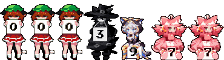
  <br/>
  <sub>Release file downloads across all my public repositories · refreshed every 6 hours</sub>
  <br/>
  <sub>Counts each file download, including pre-releases; excludes source ZIPs and clones. <a href="assets/downloads.json">Breakdown by repository</a> · artwork via <a href="https://github.com/journey-ad/Moe-Counter">Moe Counter</a></sub>
</p>

### Stats

<p>
  
  
</p>

<p align="center"><sub>online now — @daeese · @nunreasonable</sub></p>
