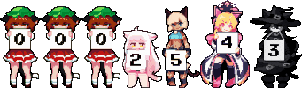

<p align="center">
  <a href="https://daeese.me">
    <picture>
      <source media="(prefers-color-scheme: dark)" srcset="assets/header-dark.svg" />
      
    </picture>
  </a>
</p>

<p align="center">
  <a href="https://daeese.me">daeese.me</a>
  &nbsp;·&nbsp;
  <a href="https://apps.daeese.me">apps.daeese.me</a>
  &nbsp;·&nbsp;
  <a href="https://github.com/nunreasonable">@nunreasonable</a>
</p>

<p align="center"></p>

```
daeese; daeeseD; nunreasonable; wtv
```

### About

Won't really say much except:

- Fullstack developer @ [VLTRA Entertainment](https://discord.gg/3qdvhkNSS8)
- I work with C#, JS, HTML & CSS, plus Luau for Roblox and lately C++ / Qt and Rust for ii on Windows

### Toolbox

<p>
  
</p>

<p align="center"></p>

### Projects

<a href="https://apps.daeese.me/illogicalwindows/">
  <picture>
    <source media="(prefers-color-scheme: dark)" srcset="assets/ii-windows-dark.svg" />
    
  </picture>
</a>

#### [ii on Windows](https://github.com/nunreasonable/ii-windows)

end-4's [illogical-impulse](https://github.com/end-4/dots-hyprland) Quickshell desktop, ported from Hyprland to run natively on Windows 10 and 11, through a Quickshell fork with a native Windows backend (C++, Qt 6 / QML, Direct3D 11, WinRT). Spotlight search, optional dwindle tiling, `Win`+drag, the Settings app, screen recording, live video wallpapers and Material You colors from your wallpaper, in two looks: ii's original or pctrade's [end4-pC](https://github.com/pctrade/end4-pC). The GUI setup is Rust / Tauri and installs per user, no admin rights needed.

Stable is **0.10.1-fix2 "Tahiti Mangosellers"**, and **1.0.0 "Jazz-Handed Octopus"** is in beta as a pre-release.

<sub>[showcase](https://apps.daeese.me/illogicalwindows/) · [download the setup](https://github.com/nunreasonable/ii-windows/releases/latest) · [quickshell fork](https://github.com/nunreasonable/quickshell/tree/windows) · [ii fork](https://github.com/nunreasonable/dots-hyprland/tree/ii-windows)</sub>

<br/>

<a href="https://apps.daeese.me/sollarety/">
  <picture>
    <source media="(prefers-color-scheme: dark)" srcset="assets/sollarety-dark.svg" />
    
  </picture>
</a>

#### [Sollarety](https://apps.daeese.me/sollarety/)

Discord bot in C# / .NET for community servers: moderation with a warning history, Roblox verification through Roblox's official sign-in, music from YouTube, SoundCloud or Spotify, and a pile of fun commands. Moderation follows your server's own Discord permissions, and it never reads your messages — it doesn't request the Message Content intent at all.

<sub>[site](https://apps.daeese.me/sollarety/) · [add to a server](https://apps.daeese.me/sollarety/invite/)</sub>

<br/>

#### More

| Project | What it is |
| --- | --- |
| **[Blood Oath: Brazil 1898](https://www.roblox.com/communities/17047605/Imperial-Engineer-Corps#!/about)** | Open-world Roblox game in Luau, set in the sertão of northeastern Brazil in 1898, the age of the cangaço. Pick a side between four factions — cangaceiros, the Volante police, jagunços and sertanejos — and build up fame, bounties and a story told in chapters, with player-founded gangs and volantes. In development by my group, the Imperial Engineer Corps.<br/><sub>[group](https://www.roblox.com/communities/17047605/Imperial-Engineer-Corps#!/about) · [discord](https://discord.com/invite/fdD6Mc6CAw)</sub> |
| **[ccore — chavinhoCORE](https://github.com/nunreasonable/cornwall-discord-application)** | The project Sollarety's infrastructure came from. Administration bot in C# / .NET for the 12° Regimento de Infantaria "Chaves" in CONSTANTES: enlistment with automatic Roblox verification, deployments, the regiment's spreadsheet and announcements. Server-locked on purpose. ccore for the 12° won't get as many updates from now on (it isn't disabled): it was the kickstart that let Sollarety shine. In the near future it may be rebranded into an "engine", my own Discord bot / app template for building any app.<br/><sub>[site](https://ccore.daeese.me/) · [terms](https://ccore.daeese.me/termsofservice/) · [privacy](https://ccore.daeese.me/privacypolicy/)</sub> |
| **[mocktail-gentoo-overlay](https://github.com/nunreasonable/mocktail-gentoo-overlay/tree/gentoo-overlay)** | Unofficial Portage overlay with ebuilds for [Mocktail](https://github.com/komaruworld/mocktail), the compatibility runtime that runs the Android x86-64 Roblox client on Linux, so Gentoo users can `emerge` it. Ships `app-emulation/mocktail` (source build plus a live `-9999`) and `app-emulation/mocktail-bin` as a prebuilt fallback.<br/><sub>ebuilds only — I maintain the packaging, not the software</sub> |
| **[VLTRA Entertainment](https://discord.gg/3qdvhkNSS8)** | Where I work as a fullstack developer — systems, gameplay and tooling in Luau. The studio's community lives on Discord.<br/><sub>[discord](https://discord.gg/3qdvhkNSS8)</sub> |

> More at **[daeese.me](https://daeese.me)** and **[apps.daeese.me](https://apps.daeese.me)**

<p align="center"></p>

### Elsewhere

<p>
  <a href="https://daeese.me"></a>
  <a href="https://apps.daeese.me"></a>
  <a href="https://discord.com/users/1402344358199689348"></a>
</p>

### Now playing

<p>
  <a href="https://discord.com/users/1402344358199689348">
    
  </a>
  <br/>
  <sub>live version on <a href="https://daeese.me">daeese.me</a></sub>
</p>

### Downloads

<p align="center">
  
  <br/>
  <sub>Release file downloads across all my public repositories · refreshed every 6 hours</sub>
  <br/>
  <sub>Counts each file download, including pre-releases; excludes source ZIPs and clones. <a href="assets/downloads.json">Breakdown by repository</a> · artwork via <a href="https://github.com/journey-ad/Moe-Counter">Moe Counter</a></sub>
</p>

### Stats

<p>
  
  
</p>

<p align="center"><sub>online now — @daeese · @nunreasonable</sub></p>
